  

  

## Hi there 

I'm **Md Hamzah**, a dedicated **Cybersecurity Specialist**, **Ethical Hacker**, and **Security Researcher** based in **Kolkata, India 🇮🇳**. I have a strong passion for penetration testing, vulnerability assessment, malware analysis, and network defense.

With a deep interest in **offensive security**, **web application pentesting**, and **security automation**, I focus on finding security flaws, understanding exploit vectors, and building robust defenses against modern cyber threats.

---

💫 More About Me:

- **Name:** Md Hamzah  
- **From:** Kolkata, West Bengal, India 🇮🇳  
- **Role:** Cybersecurity Specialist | Ethical Hacker | Security Researcher | Pentester  
- **Focus:** Offensive Security, Bug Bounty, Web Security, System Hardening  

**Specialties & Core Focus:**
- 🛡️ Web Application Security — OWASP Top 10, API Pentesting, Authentication Flaws  
- 🌐 Network Vulnerability Assessment & Reconnaissance  
- 🔍 Bug Bounty Hunting & Vulnerability Research  
- 💻 Custom Security Tooling & Scripting (Python, Bash, PowerShell, JS)  
- 🧪 Hands-on Lab Training (TryHackMe, HackTheBox, PortSwigger Academy)  
- 🔐 Linux System Hardening & Digital Forensics  

## 📌 Present Status
<table border="0" style="border-collapse: collapse;">
<tr>
  <td width="60%" valign="top">

- 🛡️ Performing hands-on penetration tests on web applications, networks, and APIs  
- 🛠️ Developing custom hacking tools, automation scripts, and privacy utilities  
- 🔍 Actively practicing on CTFs, TryHackMe, and HackTheBox labs  
- 🚀 Deep-diving into Offensive Security, Reverse Engineering, and Exploit vectors  
- 📚 Researching latest CVEs, Threat Intelligence, and Defense-in-Depth strategies  
- 🤝 Open to collaboration on cybersecurity projects, open-source security tools & bug hunting  

  </td>
  <td width="40%" valign="top" align="center">

  

  </td>
</tr>
</table>

## 🌐 Socials:
 

# 🛠 Knowledge & Skills

 
 
 
 
 
 
 
 
 
 

 
 
 
 
 

 
 
 
 
 
 
 
 
 
 
 
 
 
 

 
 
 
 
 
 
 

# 📊 GitHub Stats:
<table border="0" style="border-collapse: collapse;">
<tr>
<td width="55%" valign="top">

 

 

</td>
<td width="45%" valign="middle" align="center">

</td>
</tr>
</table>

---

**"Talk is cheap. Show me the code."**

<a>🌱</a>

---

